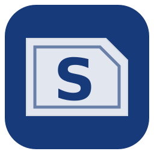
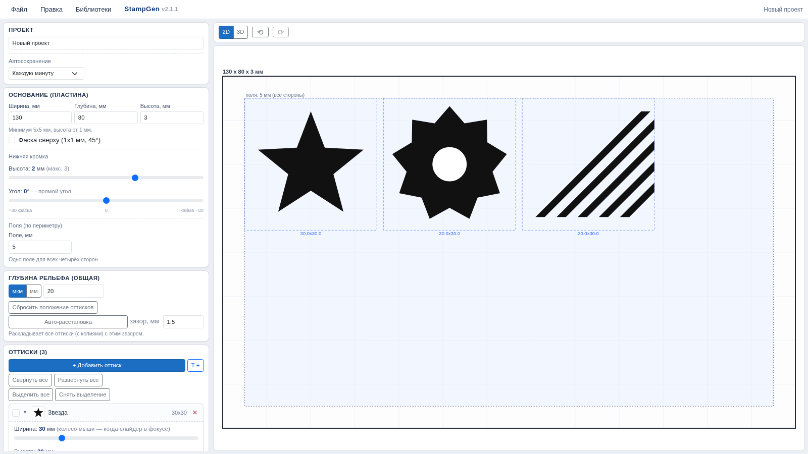
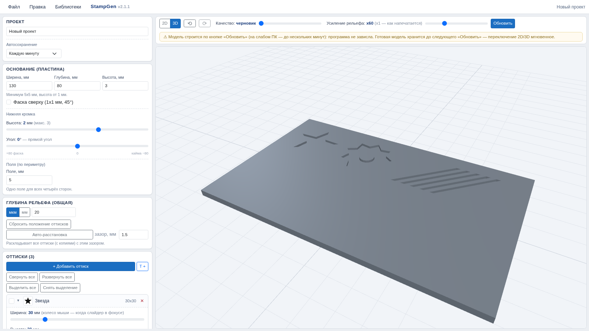

  

# StampGen

**Конструктор пластин и оттисков для печати и гравировки: SVG → 3D → STL**

*Десктопная программа на C# / .NET 10 (Blazor). Работает полностью локально — интернет не нужен, данные никуда не уходят.*

| 🖼 Конструктор (2D-схема) | 🧊 Готовая модель (3D / STL) |
|---|---|
|  |  |

---

## 📌 Библиотеки проекта и «О программе»

| Библиотеки проекта | О программе |
|---|---|
| **📦 Готовые наборы штампов** (Яндекс.Диск): [disk.yandex.ru/d/D7K6EmBD_wXu3w](https://disk.yandex.ru/d/D7K6EmBD_wXu3w)  Скачайте zip-архив и импортируйте его в программе: меню **Библиотеки → Добавить библиотеку zip…** Поддерживаются вложенные архивы (zip внутри zip, до 3 уровней).  **🛠 Своя библиотека штампов** — делается за 10 минут из любых SVG: инструкция в разделе [«Как самому сделать библиотеку штампов»](docs/INSTRUCTION.md#6-как-самому-сделать-библиотеку-штампов). | **StampGen** — конструктор оттисков и оснований (пластин) для печати и гравировки по металлу. Пользователь собирает пластину из штампов (библиотеки, свои SVG или текстовые надписи), а программа строит замкнутую (watertight) 3D-модель и экспортирует **STL, SVG, PDF, PNG и JPG**. Все расчёты выполняются локально на вашем компьютере.  Программа **бесплатна для личного (некоммерческого) использования**. Коммерческое использование, распространение и модификация — только с письменного согласия правообладателя **Guoud**.  **Коммерческое использование и согласование условий:** ✉️ **iljamakeev@yandex.ru** © Guoud. Все права защищены. |

---

## 🚀 Быстрый старт (для тех, кто «не хочет возиться со студией»)

1. **Скачайте готовый exe** из [Releases](https://github.com/Guoud1/StampGen/releases) (или соберите сами — [BUILD-EXE.md](BUILD-EXE.md)).
2. **Запустите `StampGen.exe` двойным кликом.** Браузер откроется сам.
3. **Если браузер не открылся** — адрес печатается в консоли при запуске. Откройте вручную:

   > ### http://127.0.0.1:5317
   >
   > Программа поднимает локальный сервер на первом свободном порту из диапазона **5317–5322** (точный адрес всегда виден в терминале). Можно задать порт вручную: `StampGen.exe --port=5317`.

4. Программа стартует **пустой** — импортируйте библиотеку штампов ([наборы на Яндекс.Диске](https://disk.yandex.ru/d/D7K6EmBD_wXu3w) или своя собственная) и работайте.

Подробная инструкция пользователя (интерфейс, рельеф, копии, экспорт STL) — [docs/INSTRUCTION.md](docs/INSTRUCTION.md).

Или откройте `StampGen/StampGen.csproj` в Visual Studio 2022/2026 и нажмите **F5**.

## 📖 Инструкция и документация

| Документ | Что внутри |
|---|---|
| [docs/INSTRUCTION.md](docs/INSTRUCTION.md) | Инструкция пользователя: запуск, интерфейс, библиотеки, рельеф, копии, экспорт STL/SVG/PDF/PNG/JPG, **как самому сделать библиотеку штампов**, ответы на частые вопросы. RU + EN. |
| [BUILD-EXE.md](BUILD-EXE.md) | Сборка готового exe (self-contained): `build-exe.ps1` / `build-exe.sh`. |
| [CHANGELOG.md](CHANGELOG.md) | История изменений v1.3 → v2.3.0. |

## ☕ Поддержать автора проекта

Если программа сэкономила вам время — можно просто перейти по гиперссылке и [скинуть денег на кофе для автора проекта](https://yoomoney.ru/fundraise/1LFSQ49MGAC.261111) ☕

Донат проходит через **YooMoney** и открывается обычной ссылкой в браузере.

## 🔗 Первоисточник

Оригинальный репозиторий проекта: **[github.com/Guoud1/StampGen](https://github.com/Guoud1/StampGen)** — актуальные версии, релизы и issue-трекер живут здесь.

## 🛡 Защита прав и политика

Программа бесплатна для личного (некоммерческого) использования. Коммерческое использование, распространение и модификация — только с письменного согласия правообладателя Guoud.

Коммерческое использование и согласование условий:
✉️ iljamakeev@yandex.ru
© Guoud. Все права защищены.

## 📄 Лицензия

Кратко: **бесплатно для личного некоммерческого использования; коммерческое — по согласованию с автором (iljamakeev@yandex.ru)**. Полные условия — [LICENSE.md](LICENSE.md). Сторонние компоненты (Clipper2, three.js, Bootstrap, шрифты DejaVu/Liberation) распространяются по своим собственным свободным лицензиям (см. LICENSE.md).

---

## 🇬🇧 English

**StampGen** — a designer of stamp plates for metal printing and engraving: compose a plate from stamps (libraries, your own SVG files or text captions) and export a watertight **STL**, plus **SVG / PDF / PNG / JPG**. Built with C# / .NET 10 (Blazor Web App); everything is computed locally on your machine — no internet required.

**Quick start:** download `StampGen.exe` from [Releases](https://github.com/Guoud1/StampGen/releases) → run it → your browser opens automatically. If it does not, open the address printed in the console: **http://127.0.0.1:5317** (the local server picks the first free port in 5317–5322 range). The app starts empty — import a stamp library via **Libraries → Add library zip…**

| Project libraries | About |
|---|---|
| **📦 Ready-made stamp packs** (Yandex Disk): [disk.yandex.ru/d/D7K6EmBD_wXu3w](https://disk.yandex.ru/d/D7K6EmBD_wXu3w) — download a zip and import it in the app (nested zips supported, up to 3 levels).  **🛠 Your own library** can be built from any SVG files in 10 minutes — see [*How to make your own stamp library*](docs/INSTRUCTION.md#how-to-make-your-own-stamp-library) (English user guide, section on libraries). | StampGen is free for **personal (non-commercial) use**. Commercial use, distribution and modification require written permission from the copyright holder **Guoud**.  **Commercial licensing and permissions:** ✉️ **iljamakeev@yandex.ru** © Guoud. All rights reserved. |

☕ **Support the author** — just follow the hyperlink: [YooMoney donation page](https://yoomoney.ru/fundraise/1LFSQ49MGAC.261111).

📄 Full license: [LICENSE.md](LICENSE.md) · 📖 [User guide (RU + EN)](docs/INSTRUCTION.md) · 🛠 [Building the exe](BUILD-EXE.md) · 🚀 [Publishing to GitHub](PUBLISH-TO-GITHUB.md) · 📜 [Changelog](CHANGELOG.md)

